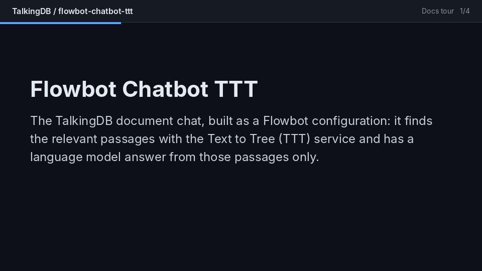

<!-- short-readme -->
<h1 align="center">flowbot-chatbot-ttt</h1>

<p align="center"><b>Chat with your documents. Answers come only from the passages TalkingDB finds.</b></p>

<p align="center"><a href="#try-it">Try it</a> · <a href="docs/architecture.md">How it works</a> · <a href="docs/troubleshooting.md">Troubleshooting</a> · <a href="docs/reference.md">Full reference</a></p>

<p align="center"><a href="https://github.com/TalkingDB/flowbot-chatbot-ttt/stargazers"></a> <a href="https://www.gnu.org/licenses/agpl-3.0.html"></a></p>

<p align="center">
  
</p>
<p align="center"><sub>Drawn from <code>server/index.js</code> and <code>server/prompt.js</code>.</sub></p>

A [flowbot-framework](https://github.com/TalkingDB/flowbot-framework) configuration: a user asks about their uploaded documents, [module-ttt](https://github.com/TalkingDB/module-ttt) finds the top passages, and a language model writes a short answer from those passages only, with sources.

## What it does

- **Find**: the question goes to TTT for the top 5 passages.
- **Answer**: a quick answer, extra context when needed, and follow-up questions, all from the passages ([how it answers](docs/architecture.md)).
- **Say so**: when the documents do not cover a question, it says that, with no made-up sources.

## Try it

```bash
# inside a flowbot-framework checkout
git clone https://github.com/TalkingDB/flowbot-chatbot-ttt.git configuration/flowbot-chatbot-ttt
yarn dev                 # http://localhost:3000/?chat-id=flowbot-chatbot-ttt
```

Set `TTT_URL` and the model key in `server/.env`; see [troubleshooting](docs/troubleshooting.md).

## Where it fits

Runs inside [flowbot-framework](https://github.com/TalkingDB/flowbot-framework); answers from [module-ttt](https://github.com/TalkingDB/module-ttt); [sdk-talkingdb](https://github.com/TalkingDB/sdk-talkingdb) makes the same queries from Python.

## Learn more

| Page | Read it to |
| :--- | :--- |
| [How it works](docs/architecture.md) | see the parts and how data moves |
| [Troubleshooting](docs/troubleshooting.md) | fix a problem |
| [Full reference](docs/reference.md) | read everything that used to be on this page |
| [All docs](docs/README.md) | see every page |

## Support TalkingDB

If flowbot-chatbot-ttt saved you time, please [give it a star](https://github.com/TalkingDB/flowbot-chatbot-ttt) ⭐. Stars help other developers find the project.

Found a bug, or a document it gets wrong? [Open an issue](https://github.com/TalkingDB/flowbot-chatbot-ttt/issues/new). We are always here to help and open to a conversation. Explore the TalkingDB applications at [talkingdb.io](https://talkingdb.io/#applications).

## License

Licensed under the GNU Affero General Public License v3.0 ([AGPL-3.0](https://www.gnu.org/licenses/agpl-3.0.html)). See [LICENSE](LICENSE).
