# Flowbot Chatbot TTT

The TalkingDB document chat, built as a configuration for the [Flowbot](https://github.com/TalkingDB/flowbot-framework) framework. A user asks a question about their uploaded documents; this chatbot finds the relevant passages with the TalkingDB Text to Tree (TTT) service and has a language model write a short answer from those passages only.


| Start here | Go deeper |
| :--- | :--- |
| [How an answer is made](#how-an-answer-is-made) | [Architecture: prompt, streaming, sources](docs/architecture.md) |
| [Set it up](#set-it-up) | [Troubleshooting](docs/troubleshooting.md) |
| [What this repo is not](#what-this-repo-is-not) | [Flowbot configuration contract](https://github.com/TalkingDB/flowbot-framework/blob/main/docs/architecture.md#the-configuration-contract) |

All pages: [docs/](docs/README.md).

## How an answer is made

<picture>
  <source media="(prefers-color-scheme: dark)" srcset="docs/images/how-the-ttt-chatbot-answers-a-question-dark.svg">
  
</picture>

<sub>Diagram source: [how-the-ttt-chatbot-answers-a-question.mmd](docs/diagrams/how-the-ttt-chatbot-answers-a-question.mmd). Edit it and re-render with the steps in [docs/diagrams](docs/diagrams/README.md).</sub>

In words: TTT finds the passages, the language model only rewrites them into an answer, and the passages are returned as sources so the user can check them.

The prompt asks for a short "Quick Answer" and, only when needed, "Additional Context". If the excerpts do not cover the question, the model must reply with a fixed message saying so, rather than guessing ([`server/index.js`](server/index.js)).

## Set it up

This repository is not run on its own. Flowbot loads it from its `configuration/` folder.

1. Place it where Flowbot's [`deploy.sh`](https://github.com/TalkingDB/flowbot-framework/blob/main/deploy.sh) copies configurations from:

   ```text
   parent/
   ├── flowbot-framework/
   └── configurations/
       └── flowbot-chatbot-ttt/      <- this repository
   ```

2. Create `server/.env` from [`server/.env.example`](server/.env.example):

   | Variable | Value |
   | :--- | :--- |
   | `TTT_URL` | The TTT query endpoint, for example `http://localhost:8090/v1/queries` |
   | `GPT_BEARER_TOKEN` | API key for the language model |

   The TTT API key is not set here. Flowbot passes it in the request headers, from its own `NEXT_PUBLIC_TDB_TTT_SERVICE_AUTHORIZATION` setting. [`webapp/.env.example`](webapp/.env.example) is empty today.

   The server reads its `.env` from `configuration/flowbot-chatbot-ttt/server/.env` inside Flowbot, so the folder name must stay `flowbot-chatbot-ttt`.

3. From `flowbot-framework`, run `./deploy.sh` ([Docker](https://docs.docker.com/get-started/docker-overview/)) or copy the folder into `configuration/` and run `yarn dev`.

4. Open Flowbot with `?chat-id=flowbot-chatbot-ttt`, upload a document, and ask a question.

## What this repo is not

- **Not a search engine.** Retrieval is done by [module-ttt](https://github.com/TalkingDB/module-ttt); this repository only calls it.
- **Not a free answer generator.** The model is told to answer only from the retrieved excerpts and to say when they do not cover the question.
- **Not standalone.** It needs Flowbot to provide sign in, the chat window, history and streaming.

## Related repositories

| Repository | Relationship |
| :--- | :--- |
| [flowbot-framework](https://github.com/TalkingDB/flowbot-framework) | The app this configuration runs inside |
| [module-ttt](https://github.com/TalkingDB/module-ttt) | The document search behind every answer |
| [sdk-talkingdb](https://github.com/TalkingDB/sdk-talkingdb) | The same TTT queries from Python |

## Further reading

- [OpenAI chat completions API](https://platform.openai.com/docs/api-reference/chat)
- [Retrieval augmented generation](https://en.wikipedia.org/wiki/Retrieval-augmented_generation)
- [Prompt injection (OWASP)](https://genai.owasp.org/llmrisk/llm01-prompt-injection/), which the prompt's "reference text only" rule guards against

## Contributor

Mayank Gupta, mayank.g@smarter.codes

## License

Licensed under the GNU Affero General Public License v3.0 ([AGPL-3.0](https://www.gnu.org/licenses/agpl-3.0.html)). See [LICENSE](LICENSE).
