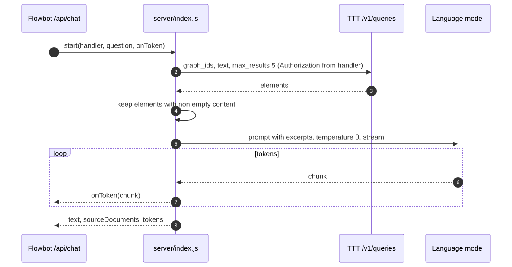

# Architecture

[Docs home](README.md) › Architecture

What each file does and how one answer is produced. For setup, start at the [README](../README.md).

## Files

| File | Role |
| :--- | :--- |
| [`server/index.js`](../server/index.js) | The answering logic: `start(handler, question, onToken)`, the TTT request, the prompt, the streamed model call and the response shape |
| [`server/prompt.js`](../server/prompt.js) | A copy of the prompt and fixed messages. `server/index.js` does not import it; it defines its own copy, so edit both or remove one |
| [`webapp/index.js`](../webapp/index.js) | What the chat window shows: title "AI Document Chat", welcome text, placeholder, theme colour, bot name "TalkingDB", panel switches, Google sign in settings |
| [`webapp/Index.module.css`](../webapp/Index.module.css) | Chat window styling |

Both modules follow the [Flowbot configuration contract](https://github.com/TalkingDB/flowbot-framework/blob/main/docs/architecture.md#the-configuration-contract). The server module sets `streaming = true`, `conversational = true` and `pollingInterval = 400`.

## One answer, step by step

<picture>
  <source media="(prefers-color-scheme: dark)" srcset="images/one-answer-from-the-ttt-chatbot-dark.svg">
  
</picture>

<sub>Diagram source: [one-answer-from-the-ttt-chatbot.mmd](diagrams/one-answer-from-the-ttt-chatbot.mmd). Edit it and re-render with the steps in [docs/diagrams](diagrams/README.md).</sub>

In words: the bot asks TTT for five passages, gives only those to the model, streams the model's words back through Flowbot, and returns the passages as sources.

## What `start` returns

```text
{
  text:            the answer (or a fixed fallback message)
  src:             "talkingDb"
  sourceDocuments: the TTT elements, shaped as { pageContent, metadata }
  currentStep, error, errorMessage, hideAnswer
  tokens:          { input_tokens, output_tokens, total_tokens }
}
```

Flowbot records `tokens` against the user after each answer.

## Fixed messages

| When | Message |
| :--- | :--- |
| The user has no documents (no graph IDs) | "Please upload a document to train" |
| The excerpts do not cover the question (the model must say this) | "The documents I have access to don't cover this. Try rephrasing the question please..." |
| Nothing came back at all | "Sorry, I don't have an answer for that." |

## Guarding the prompt

The excerpts are wrapped in `<document_excerpts>` tags, and the prompt tells the model to treat everything inside as reference text, never as instructions. This reduces the chance that text inside an uploaded document steers the model ([prompt injection](https://genai.owasp.org/llmrisk/llm01-prompt-injection/)).

---

**Related:** [Troubleshooting](troubleshooting.md) · [README](../README.md)
